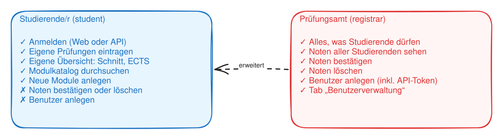
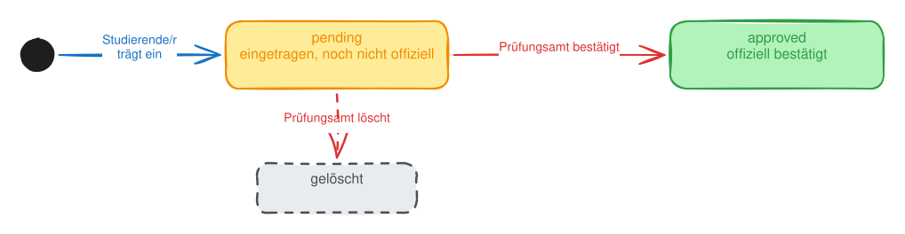
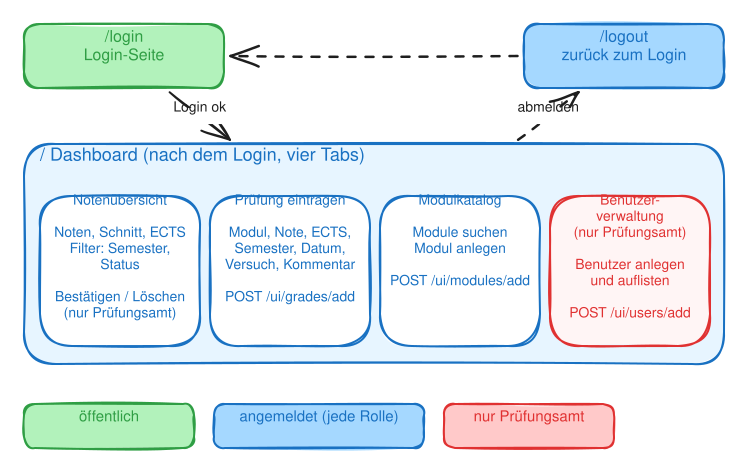

# GradeTrack

**Notenverwaltung für Studierende und Prüfungsamt: Flask-Web-App mit REST-API**

GradeTrack ist das Basisprogramm unserer Prüfungsleistung im Modul *Security by Design*. Studierende tragen ihre Prüfungsnoten ein, das Prüfungsamt bestätigt sie
offiziell. An dieser App zeigen wir, wie Build, Tests, Betrieb und weitere
DevSecOps-Maßnahmen sinnvoll eingerichtet und begründet werden.

**Team:** Tobias Gehrke, Pavel Kullmann, Anastasia Rotermel

> [!WARNING]
> Die Ausgangsversion (Tag `baseline-vulnerable`, Branch `vulnerable`) enthält **absichtlich
> Schwachstellen**
> Sie dient als Angriffsfläche für unsere Positivtests. Nur `main` wird abgesichert.

## Inhalt

- [Was die App macht](#was-die-app-macht)
- [Rollen](#rollen)
- [Aufbau](#aufbau)
- [Seiten und Endpunkte](#seiten-und-endpunkte)
- [Schnellstart](#schnellstart)
- [Projektstruktur](#projektstruktur)
- [Mitarbeiten](#mitarbeiten)
- [Prüfungsleistung: Stand](#prüfungsleistung-stand)

---

## Was die App macht

- **Studierende** melden sich an, tragen Prüfungsleistungen ein (Modul, Note, ECTS, Semester,
  Datum, Versuch, Kommentar) und sehen ihre Übersicht: ECTS-gewichteter Notenschnitt,
  bestandene und offene Prüfungen, ECTS pro Semester.
- **Das Prüfungsamt** bestätigt oder löscht eingetragene Noten und legt neue Benutzer an.
  Jeder Benutzer erhält dabei automatisch einen API-Token.
- **Module** lassen sich im Katalog suchen und neu anlegen.
- Bedient wird GradeTrack über die **Weboberfläche** oder per **JSON-API**. Die Anmeldung
  läuft über eine Session (Login-Formular) oder über einen API-Token im Header `X-API-Token`.

**Schützenswert** sind vor allem:
- die **Integrität der Noten**: nur das Prüfungsamt darf sie bestätigen,
- **Passwörter und API-Tokens**,
- die **personenbezogenen Daten** der Studierenden.

Das ausführliche Schutzkonzept mit allen Nachweisen folgt in
[`docs/schutzkonzept.md`](docs/schutzkonzept.md).


## Rollen

| Rolle | Darf |
|---|---|
| `student` (Studierende/r) | eigene Noten eintragen und einsehen, Module suchen und anlegen |
| `registrar` (Prüfungsamt) | alles wie `student`, zusätzlich Noten aller Studierenden sehen, bestätigen und löschen sowie Benutzer anlegen |



### Lebenszyklus einer Note

Eine Note ist nach dem Eintragen **`pending`** und wird erst durch die Bestätigung des
Prüfungsamts **`approved`**.



## Aufbau

Jede Anfrage durchläuft zwei Prüfungen: **Wer bist du?** (Authentifizierung) und
**Was darfst du?** (Rolle). Erst danach greift die App auf die SQLite-Datenbank zu.


## Seiten und Endpunkte

Die Farben zeigen, wer zugreifen darf: **grün** öffentlich, **blau** jede angemeldete
Rolle, **rot** nur das Prüfungsamt.

### Weboberfläche



### REST-API (JSON)


<details>
<summary><b>Alle Endpunkte als Tabelle</b></summary>

#### Weboberfläche

| Methode | Pfad | Zweck | Zugriff |
|---|---|---|---|
| GET, POST | `/login` | Anmeldung | öffentlich |
| GET | `/logout` | Abmeldung | angemeldet |
| GET | `/` | Dashboard; Filter `semester`, `status`, `student_id`, `search`, `tab` | angemeldet |
| POST | `/ui/grades/add` | Note eintragen | angemeldet |
| POST | `/ui/modules/add` | Modul anlegen | angemeldet |
| POST | `/ui/grades/{id}/approve` | Note bestätigen | Prüfungsamt |
| POST | `/ui/grades/{id}/delete` | Note löschen | Prüfungsamt |
| POST | `/ui/users/add` | Benutzer anlegen | Prüfungsamt |

#### REST-API (JSON)

| Methode | Pfad | Zweck | Zugriff |
|---|---|---|---|
| GET | `/health` | Statusprüfung inkl. Datenbank (`200` ok, `503` gestört) | öffentlich |
| POST | `/auth/login`, `/auth/logout` | An- und Abmeldung, liefert API-Token | öffentlich |
| GET | `/modules` | Module suchen (`search`) | öffentlich |
| POST | `/modules` | Modul anlegen | angemeldet |
| GET | `/grades` | Noten auflisten (`semester`, `student_id`, `status`, `sort`) | angemeldet |
| POST | `/grades` | Note anlegen | angemeldet |
| GET, PUT | `/grades/{id}` | Note lesen, ändern | angemeldet |
| GET | `/stats/ects` | Notenschnitt und ECTS (`student_id`, `semester`) | angemeldet |
| GET | `/users` | Benutzer auflisten | angemeldet |
| POST | `/grades/{id}/approve` | Note bestätigen | Prüfungsamt |
| DELETE | `/grades/{id}` | Note löschen | Prüfungsamt |
| POST | `/users` | Benutzer anlegen | Prüfungsamt |

</details>

---

## Schnellstart

**Voraussetzungen:** Python 3.14 und Git (oder nur Docker, siehe
[Mit Docker bauen und starten](#mit-docker-bauen-und-starten))

**Windows (Git Bash)**
```bash
python -m venv .venv
source .venv/Scripts/activate
python -m pip install --require-hashes -r requirements.txt
export GRADETRACK_SECRET_KEY="$(python -c 'import secrets; print(secrets.token_urlsafe(32))')"
export GRADETRACK_DEMO_DATA=1 GRADETRACK_SECURE_COOKIES=0
python gradetrack.py
```

**Linux / macOS**
```bash
python3 -m venv .venv
source .venv/bin/activate
python -m pip install --require-hashes -r requirements.txt
export GRADETRACK_SECRET_KEY="$(python -c 'import secrets; print(secrets.token_urlsafe(32))')"
export GRADETRACK_DEMO_DATA=1 GRADETRACK_SECURE_COOKIES=0
python gradetrack.py
```

Die App läuft dann auf **http://localhost:5000**. Beim ersten Start wird die Datenbank
`grades.db` automatisch angelegt. Mit `python gradetrack.py --init-db` setzt ihr sie zurück.

**Einstellungen** (siehe [`.env.example`](.env.example)):

| Variable | Bedeutung | Standard |
|---|---|---|
| `GRADETRACK_SECRET_KEY` | Schlüssel für Session-Cookies, mind. 32 Zeichen. **Ohne ihn startet die App nicht.** | – |
| `GRADETRACK_DEMO_DATA` | `1` legt Beispielbenutzer und -noten mit bekannten Passwörtern an (nur Demo und Tests) | `0` |
| `GRADETRACK_SECURE_COOKIES` | `1` sendet das Session-Cookie nur über HTTPS. Für lokale Tests über `http://` auf `0` | `1` |
| `GRADETRACK_HOST`, `GRADETRACK_PORT`, `GRADETRACK_DEBUG` | Nur für den Entwicklungsserver | `127.0.0.1`, `5000`, `0` |

Ohne Beispieldaten legt ihr einen Zugang für das Prüfungsamt so an (das Passwort wird
verdeckt abgefragt): `python gradetrack.py --create-registrar <name>`

### API ausprobieren

```bash
# Anmelden: die Antwort enthält "api_token"
curl -X POST http://localhost:5000/auth/login \
     -H "Content-Type: application/json" \
     -d '{"username": "<benutzer>", "password": "<passwort>"}'

# Noten mit dem Token abrufen
curl http://localhost:5000/grades -H "X-API-Token: <token>"
```

### Mit Docker bauen und starten

GradeTrack wird als Docker-Image ausgeliefert. So laufen Tests und Betrieb überall mit
derselben Python-Version und denselben Paketen.

**Bauen** (braucht Docker und Git):

```bash
bash scripts/build.sh
```

Das Skript baut das Image aus dem [`Dockerfile`](Dockerfile) und taggt es als
`gradetrack:<commit>` und `gradetrack:latest`. Der Commit steht zusätzlich als Label
`org.opencontainers.image.revision` im Image, so lässt sich jedes Image einem Stand zuordnen.
Mit `IMAGE=<name> bash scripts/build.sh` wählt ihr einen anderen Image-Namen.

**Starten:**

```bash
cp .env.example .env        # einmalig, Werte eintragen
docker run --rm -p 127.0.0.1:8000:8000 \
    --env-file .env \
    -v gradetrack-data:/data \
    gradetrack:latest
```

Die App läuft dann auf **http://localhost:8000**. Die Datenbank liegt im Volume
`gradetrack-data` und bleibt bei einem Neustart erhalten. Zurücksetzen:
`docker volume rm gradetrack-data`. Für die Demo mit Beispielbenutzern in `.env`
`GRADETRACK_DEMO_DATA=1` setzen. Weil die App im Container nur per HTTP erreichbar ist,
für lokale Tests im Browser außerdem `GRADETRACK_SECURE_COOKIES=0` (im Betrieb terminiert
ein Reverse-Proxy HTTPS).

**Was das Image absichert:**

- **Feste Basis:** `python:3.14-slim` ist per Digest gepinnt, die Pakete werden nur aus dem
  Lock-File und mit `--require-hashes` installiert.
- **Kein root:** Die App läuft als Benutzer `gradetrack` (UID 10001). Der Code gehört root
  und ist für die App nur lesbar, beschreibbar ist nur `/data`.
- **Produktionsserver:** `gunicorn` statt des Flask-Entwicklungsservers, damit ist auch der
  Debug-Modus im Container aus.
- **Keine Secrets im Image:** `.env`, Datenbank, `.git`, Tests und Doku schließt
  [`.dockerignore`](.dockerignore) aus. Einstellungen kommen erst beim Start per `--env-file`.
- **Nur lokal erreichbar:** `-p 127.0.0.1:8000:8000` gibt den Port nur auf dem eigenen
  Rechner frei, nicht im ganzen Netz.

### Health Check

`GET /health` prüft, ob die App ihre Datenbank wirklich nutzen kann: Die Datei muss
vorhanden und lesbar sein und die Tabellen `users`, `modules` und `grades` enthalten. Die
Verbindung ist schreibgeschützt (`mode=ro`), der Check legt also nie versehentlich eine
leere Datenbank an.

| Zustand | HTTP-Status | Antwort |
|---|---|---|
| gesund | `200` | `{"status": "ok", "checks": {"database": "ok"}}` |
| gestört | `503` | `{"status": "error", "checks": {"database": "error"}}` |

Die Antwort verrät keine Pfade oder Fehlermeldungen. Den Grund schreibt die App als
JSON-Zeile `health_failed` (mit `check` und `reason`) ins Log.

Im Container ruft Docker den Endpunkt über den `HEALTHCHECK` im [`Dockerfile`](Dockerfile)
alle 30 Sekunden auf. Nach drei Fehlschlägen hintereinander gilt der Container als
`unhealthy`. Den Zustand zeigt `docker ps` in der Spalte `STATUS`, Details liefert:

```bash
docker inspect --format '{{json .State.Health}}' <container>
```

### Health-Check-Skript

[`scripts/healthcheck.py`](scripts/healthcheck.py) fragt `/health` von außen ab und gibt
genau eine Zeile aus: `HEALTHY` oder `UNHEALTHY` mit Grund. Es braucht nur die
Python-Standardbibliothek und läuft deshalb auch ohne venv, z. B. per Cron oder aus einem
Monitoring-Tool, das den Exit-Code auswertet.

Ohne Optionen prüft das Skript den Container auf Port 8000. Mit `--url` wird eine andere
Adresse geprüft, z. B. der Entwicklungsserver. `--timeout` und `--max-dauer` setzen strengere
oder lockerere Zeitgrenzen in Sekunden.

```bash
python scripts/healthcheck.py
python scripts/healthcheck.py --url http://127.0.0.1:5000/health
python scripts/healthcheck.py --timeout 3 --max-dauer 1
```

| Exit-Code | Bedeutung |
|---|---|
| `0` | `HEALTHY`: `/health` antwortet mit `200`, alle Prüfungen `ok`, schneller als `--max-dauer` (Standard 2 s) |
| `1` | `UNHEALTHY`: App nicht erreichbar, keine Antwort innerhalb `--timeout` (Standard 5 s), Antwort `503`, zu langsam oder kein gültiges JSON |
| `2` | falscher Aufruf, z. B. keine `http(s)`-URL |

Beispiel:

```
HEALTHY: http://127.0.0.1:8000/health - HTTP 200 in 0.01 s, Prüfungen ok: database
UNHEALTHY: http://127.0.0.1:8000/health - HTTP 503, fehlerhafte Prüfung: database
```

**Ungesunden Zustand beheben:**

| Meldung | Wahrscheinliche Ursache | Behebung |
|---|---|---|
| `App nicht erreichbar (Verbindung abgelehnt)` | Container läuft nicht, ist beim Start abgestürzt oder der Port stimmt nicht | `docker ps -a` zeigt, ob der Container läuft. `docker logs <container>` zeigt den Grund, meist fehlt `GRADETRACK_SECRET_KEY` oder ist zu kurz: `.env` prüfen und neu starten. Läuft er, Portfreigabe `-p 127.0.0.1:8000:8000` und `--url` prüfen. |
| `keine Antwort innerhalb von … s` / `Antwort zu langsam` | App hängt oder ist überlastet, die Datenbank ist gesperrt | `docker logs <container>` auf `internal_error` prüfen, dann `docker restart <container>`. Tritt es wiederholt auf, Last und gleichzeitige Schreibzugriffe untersuchen. |
| `HTTP 503, fehlerhafte Prüfung: database` | Datenbankdatei fehlt, Volume nicht eingebunden, keine Leserechte oder Tabellen fehlen | Im Log steht `health_failed` mit `reason`. `OperationalError`: Ist das Volume eingebunden (`-v gradetrack-data:/data`, `docker volume inspect gradetrack-data`) und gehört `/data` dem Benutzer `gradetrack` (UID 10001)? `schema_incomplete`: Datenbank aus einer Sicherung wiederherstellen. **Achtung:** Startet der Container ohne Datenbank neu, legt die App eine neue, leere an. Vorher sichern, sonst sind die Noten weg. |
| `kein JSON` / `keine gültige HTTP-Antwort` | Unter der URL antwortet ein anderer Dienst | `--url` und Port prüfen. |

### Abhängigkeiten

Die direkten Abhängigkeiten stehen in `requirements.in`. Daraus erzeugt `pip-compile` das
Lock-File `requirements.txt` mit exakten Versionen und SHA-256-Prüfsummen. Installiert wird
immer mit `--require-hashes`, damit nachträglich veränderte Pakete auffallen.

```bash
python -m pip install pip-tools
pip-compile --generate-hashes requirements.in
```

Werkzeuge für Entwicklung und CI (`pip-audit`, `cyclonedx-bom`, `pytest`, `bandit`, `mypy`, `pre-commit`) stehen getrennt davon in `requirements-dev.in` und
sind genauso mit Hashes in `requirements-dev.txt` festgeschrieben. Erzeugt wird die Datei ohne
Kommentare:

```bash
pip-compile --generate-hashes --allow-unsafe --strip-extras --no-header --no-annotate \
    -o requirements-dev.txt requirements-dev.in
sed -i '/^#/d' requirements-dev.txt
```

### Supply Chain prüfen

Der Workflow [`supply-chain.yml`](.github/workflows/supply-chain.yml) läuft bei jedem Push und
Pull Request auf `main`, wöchentlich sowie manuell (*Actions → Supply Chain → Run workflow*):

- **Pinning:** `scripts/check-pinning.sh` schlägt fehl, wenn eine GitHub Action oder ein
  pre-commit-Hook nicht per Commit-SHA oder ein Docker-Image nicht per Digest referenziert ist. Der zugehörige
  Release-Tag jeder Action steht im Namen des jeweiligen Workflow-Schritts.
- **Bekannte Sicherheitslücken:** `pip-audit` prüft alle Pakete aus `requirements.txt` gegen
  die Python Packaging Advisory Database und schlägt bei einem Fund fehl.
- **SBOM:** `cyclonedx-py` erzeugt aus `requirements.txt` eine Software-Stückliste im
  CycloneDX-Format. Sie hängt an jedem Lauf als Artefakt `sbom`; eine aktuelle Kopie liegt in
  [`docs/evidence/sbom.cdx.json`](docs/evidence/sbom.cdx.json).

Lokal ausführen:

```bash
python -m pip install --require-hashes -r requirements-dev.txt
pip-audit -r requirements.txt --require-hashes --disable-pip
bash scripts/check-pinning.sh
cyclonedx-py requirements requirements.txt --pyproject pyproject.toml --of JSON -o sbom.cdx.json
```


### Code Security prüfen

Der Workflow [`code-security.yml`](.github/workflows/code-security.yml) läuft bei jedem Push und
Pull Request auf `main` sowie manuell. Über *Actions → Code Security → Run workflow* lässt sich
im Feld `ref` auch ein anderer Stand prüfen, z. B. `vulnerable`.

- **SAST:** [Bandit](https://bandit.readthedocs.io/) prüft den Python-Code auf typische
  Schwachstellen (SQL per String, schwache Hashes, hartkodierte Secrets, …).
- **Secret Scanning:** [gitleaks](https://github.com/gitleaks/gitleaks) durchsucht die
  **ganze Git-History**. Neben den Standardregeln erkennt [`.gitleaks.toml`](.gitleaks.toml)
  GradeTrack-Tokens (`gt_…`) und fest eingetragene `SECRET_KEY`-Werte.
- **Type Checker:** `mypy` im Modus `strict` (Konfiguration in `pyproject.toml`).
- **Fail Fast:** [`tests/test_fail_fast.py`](tests/test_fail_fast.py) prüft, dass ungültige
  Eingaben sofort mit 400 abgelehnt werden. Die Tests laufen mit allen anderen im Workflow
  *Dynamictest*.

Jeder Fund lässt den Lauf fehlschlagen. Die Ergebnisse stehen in der Zusammenfassung des Laufs
und als Artefakte (`bandit-report`, `gitleaks-report`, `mypy-report`). Nachweise, dass die
Werkzeuge echte Probleme finden, liegen in [`docs/evidence/`](docs/evidence/)
(`code-security_*_positivtest.txt`).

Dieselben Prüfungen laufen vor jedem Commit über [pre-commit](https://pre-commit.com/):

```bash
source .venv/Scripts/activate        # unter Linux/macOS: source .venv/bin/activate
python -m pip install --require-hashes -r requirements.txt -r requirements-dev.txt
pre-commit install                   # einmalig: Hook in .git/hooks eintragen
pre-commit run --all-files           # alle Prüfungen von Hand ausführen
```

Lokal einzeln ausführen:

```bash
bandit -c pyproject.toml -r .
mypy
python -m pytest tests/test_fail_fast.py
```

---

## Projektstruktur

```
GradeTrack/
├── gradetrack.py        # Anwendung (Routen, Auth, Datenbankzugriff)
├── templates/           # HTML-Templates (Login, Dashboard)
├── static/              # Bilder
├── Dockerfile           # Container-Image (Base per Digest, Non-Root, gunicorn)
├── .env.example         # Vorlage für Laufzeit-Einstellungen (.env nie committen)
├── requirements.in      # direkte Abhängigkeiten
├── requirements.txt     # Lock-File mit Versionen und Hashes (generiert)
├── requirements-dev.*   # CI-Werkzeuge (pip-audit, cyclonedx-bom), mit Hashes
├── pyproject.toml       # Projekt-Metadaten (Name/Version, u. a. für die SBOM)
├── .github/workflows/   # CI: Supply Chain (Pinning, pip-audit, SBOM)
├── docs/
│   ├── img/             # Diagramme (Excalidraw)
│   └── evidence/        # Nachweise: Reports, Screenshots, CI-Läufe
├── scripts/             # build.sh (Image bauen), check-pinning.sh
└── tests/               # automatisierte Tests
```

Die Diagramme in `docs/img/` sind `.excalidraw.svg`-Dateien. Sie werden als Bild angezeigt
und lassen sich in [excalidraw.com](https://excalidraw.com) direkt öffnen und weiter
bearbeiten (*Menü → Öffnen*), denn die Szene ist in der SVG eingebettet.

## Mitarbeiten

- `main` ist der stabile, abgesicherte Stand - enforced durch Ruleset. Änderungen kommen nur per **Pull Request**.
- `vulnerable` friert den unsicheren Ausgangsstand für Positivtests ein und wird **nie**
  gemergt.
- Commit-Nachrichten folgen [Conventional Commits](https://www.conventionalcommits.org/de/),
  z. B. `fix: SQL-Injection in /grades behoben` oder `docs: Schutzkonzept Feld 2`.

---
