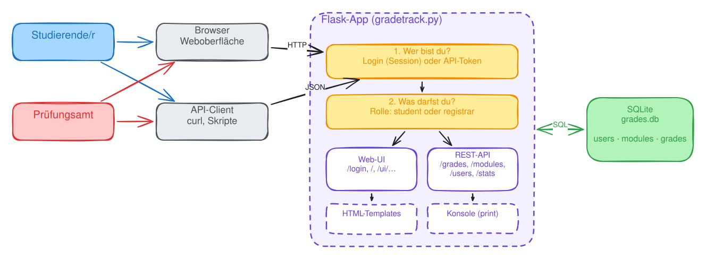
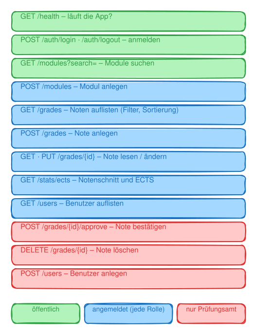

# GradeTrack

**Notenverwaltung für Studierende und Prüfungsamt: Flask-Web-App mit REST-API**

GradeTrack ist das Basisprogramm unserer Prüfungsleistung im Modul *Security by Design*. Studierende tragen ihre Prüfungsnoten ein, das Prüfungsamt bestätigt sie
offiziell. An dieser App zeigen wir, wie Build, Tests, Betrieb und weitere
DevSecOps-Maßnahmen sinnvoll eingerichtet und begründet werden.

**Team:** Tobias Gehrke, Pavel Kullmann, Anastasia Rotermel

> [!WARNING]
> Die Ausgangsversion (Tag `baseline-vulnerable`, Branch `vulnerable`) enthält **absichtlich
> Schwachstellen**
> Sie dient als Angriffsfläche für unsere Positivtests. Nur `main` wird abgesichert.

## Inhalt

- [Was die App macht](#was-die-app-macht)
- [Rollen](#rollen)
- [Aufbau](#aufbau)
- [Seiten und Endpunkte](#seiten-und-endpunkte)
- [Schnellstart](#schnellstart)
- [Projektstruktur](#projektstruktur)
- [Mitarbeiten](#mitarbeiten)
- [Prüfungsleistung: Stand](#prüfungsleistung-stand)

---

## Was die App macht

- **Studierende** melden sich an, tragen Prüfungsleistungen ein (Modul, Note, ECTS, Semester,
  Datum, Versuch, Kommentar) und sehen ihre Übersicht: ECTS-gewichteter Notenschnitt,
  bestandene und offene Prüfungen, ECTS pro Semester.
- **Das Prüfungsamt** bestätigt oder löscht eingetragene Noten und legt neue Benutzer an.
  Jeder Benutzer erhält dabei automatisch einen API-Token.
- **Module** lassen sich im Katalog suchen und neu anlegen.
- Bedient wird GradeTrack über die **Weboberfläche** oder per **JSON-API**. Die Anmeldung
  läuft über eine Session (Login-Formular) oder über einen API-Token im Header `X-API-Token`.

**Schützenswert** sind vor allem:
- die **Integrität der Noten**: nur das Prüfungsamt darf sie bestätigen,
- **Passwörter und API-Tokens**,
- die **personenbezogenen Daten** der Studierenden.

Das ausführliche Schutzkonzept mit allen Nachweisen folgt in
[`docs/schutzkonzept.md`](docs/schutzkonzept.md).


## Rollen

| Rolle | Darf |
|---|---|
| `student` (Studierende/r) | eigene Noten eintragen und einsehen, Module suchen und anlegen |
| `registrar` (Prüfungsamt) | alles wie `student`, zusätzlich Noten aller Studierenden sehen, bestätigen und löschen sowie Benutzer anlegen |


### Lebenszyklus einer Note

Eine Note ist nach dem Eintragen **`pending`** und wird erst durch die Bestätigung des
Prüfungsamts **`approved`**.


## Aufbau

Jede Anfrage durchläuft zwei Prüfungen: **Wer bist du?** (Authentifizierung) und
**Was darfst du?** (Rolle). Erst danach greift die App auf die SQLite-Datenbank zu.



## Seiten und Endpunkte

Die Farben zeigen, wer zugreifen darf: **grün** öffentlich, **blau** jede angemeldete
Rolle, **rot** nur das Prüfungsamt.

### Weboberfläche


### REST-API (JSON)



<details>
<summary><b>Alle Endpunkte als Tabelle</b></summary>

#### Weboberfläche

| Methode | Pfad | Zweck | Zugriff |
|---|---|---|---|
| GET, POST | `/login` | Anmeldung | öffentlich |
| GET | `/logout` | Abmeldung | angemeldet |
| GET | `/` | Dashboard; Filter `semester`, `status`, `student_id`, `search`, `tab` | angemeldet |
| POST | `/ui/grades/add` | Note eintragen | angemeldet |
| POST | `/ui/modules/add` | Modul anlegen | angemeldet |
| POST | `/ui/grades/{id}/approve` | Note bestätigen | Prüfungsamt |
| POST | `/ui/grades/{id}/delete` | Note löschen | Prüfungsamt |
| POST | `/ui/users/add` | Benutzer anlegen | Prüfungsamt |

#### REST-API (JSON)

| Methode | Pfad | Zweck | Zugriff |
|---|---|---|---|
| GET | `/health` | Statusprüfung | öffentlich |
| POST | `/auth/login`, `/auth/logout` | An- und Abmeldung, liefert API-Token | öffentlich |
| GET | `/modules` | Module suchen (`search`) | öffentlich |
| POST | `/modules` | Modul anlegen | angemeldet |
| GET | `/grades` | Noten auflisten (`semester`, `student_id`, `status`, `sort`) | angemeldet |
| POST | `/grades` | Note anlegen | angemeldet |
| GET, PUT | `/grades/{id}` | Note lesen, ändern | angemeldet |
| GET | `/stats/ects` | Notenschnitt und ECTS (`student_id`, `semester`) | angemeldet |
| GET | `/users` | Benutzer auflisten | angemeldet |
| POST | `/grades/{id}/approve` | Note bestätigen | Prüfungsamt |
| DELETE | `/grades/{id}` | Note löschen | Prüfungsamt |
| POST | `/users` | Benutzer anlegen | Prüfungsamt |

</details>

---

## Schnellstart

**Voraussetzungen:** Python 3.12 und Git

**Windows (Git Bash)**
```bash
python -m venv .venv
source .venv/Scripts/activate
python -m pip install --require-hashes -r requirements.txt
python gradetrack.py
```

**Linux / macOS**
```bash
python3 -m venv .venv
source .venv/bin/activate
python -m pip install --require-hashes -r requirements.txt
python gradetrack.py
```

Die App läuft dann auf **http://localhost:5000**. Beim ersten Start wird die Datenbank
`grades.db` automatisch mit Beispieldaten angelegt. Mit `python gradetrack.py --init-db`
setzt ihr sie auf die Beispieldaten zurück.

### API ausprobieren

```bash
# Anmelden: die Antwort enthält "api_token"
curl -X POST http://localhost:5000/auth/login \
     -H "Content-Type: application/json" \
     -d '{"username": "<benutzer>", "password": "<passwort>"}'

# Noten mit dem Token abrufen
curl http://localhost:5000/grades -H "X-API-Token: <token>"
```

### Abhängigkeiten

Die direkten Abhängigkeiten stehen in `requirements.in`. Daraus erzeugt `pip-compile` das
Lock-File `requirements.txt` mit exakten Versionen und SHA-256-Prüfsummen. Installiert wird
immer mit `--require-hashes`, damit nachträglich veränderte Pakete auffallen.

```bash
python -m pip install pip-tools
pip-compile --generate-hashes requirements.in
```

---

## Projektstruktur

```
GradeTrack/
├── gradetrack.py        # Anwendung (Routen, Auth, Datenbankzugriff)
├── templates/           # HTML-Templates (Login, Dashboard)
├── static/              # Bilder
├── requirements.in      # direkte Abhängigkeiten
├── requirements.txt     # Lock-File mit Versionen und Hashes (generiert)
├── docs/
│   ├── img/             # Diagramme (Excalidraw)
│   └── evidence/        # Nachweise: Reports, Screenshots, CI-Läufe
├── scripts/             # Build- und Betriebsskripte
└── tests/               # automatisierte Tests
```

Die Diagramme in `docs/img/` sind `.excalidraw.svg`-Dateien. Sie werden als Bild angezeigt
und lassen sich in [excalidraw.com](https://excalidraw.com) direkt öffnen und weiter
bearbeiten (*Menü → Öffnen*), denn die Szene ist in der SVG eingebettet.

## Mitarbeiten

- `main` ist der stabile, abgesicherte Stand - enforced durch Ruleset. Änderungen kommen nur per **Pull Request**.
- `vulnerable` friert den unsicheren Ausgangsstand für Positivtests ein und wird **nie**
  gemergt.
- Commit-Nachrichten folgen [Conventional Commits](https://www.conventionalcommits.org/de/),
  z. B. `fix: SQL-Injection in /grades behoben` oder `docs: Schutzkonzept Feld 2`.

---
